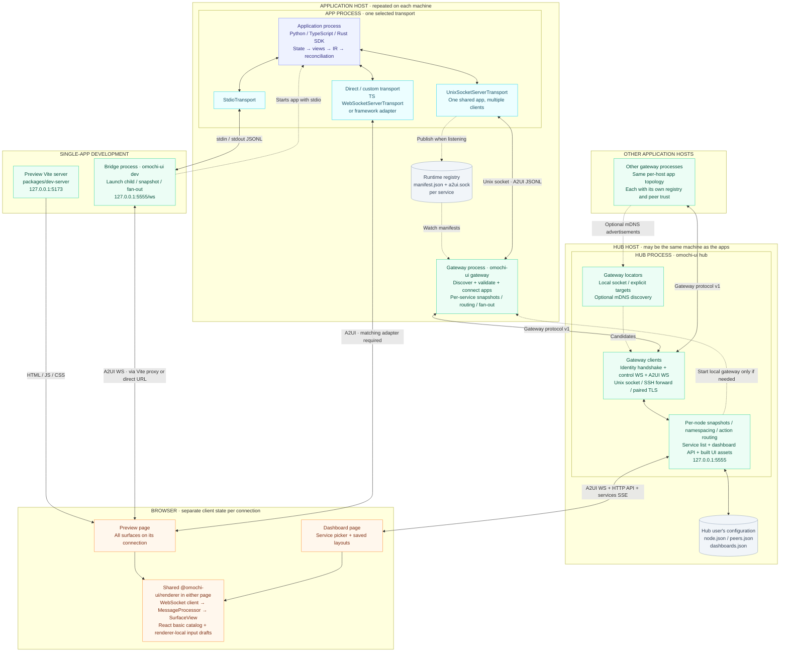
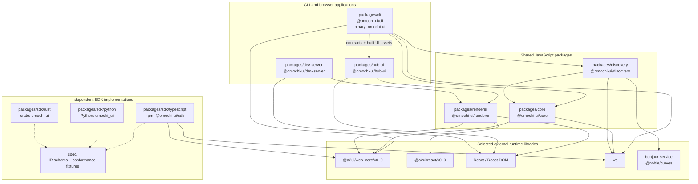
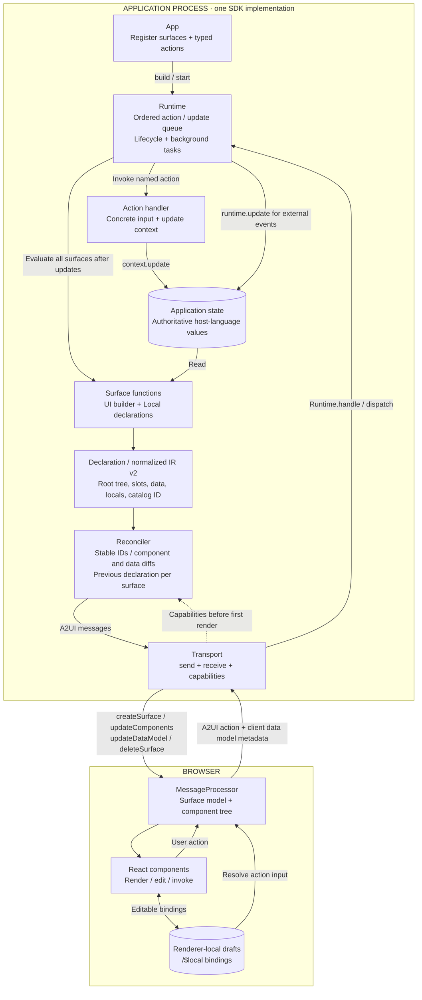
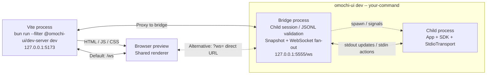
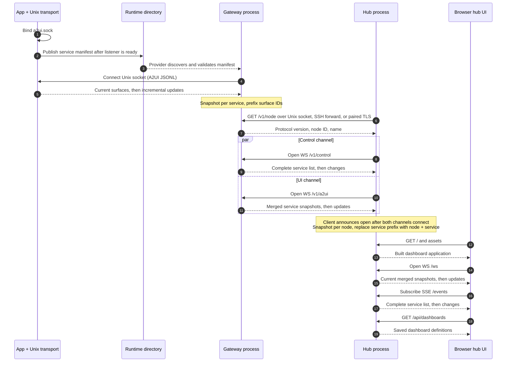
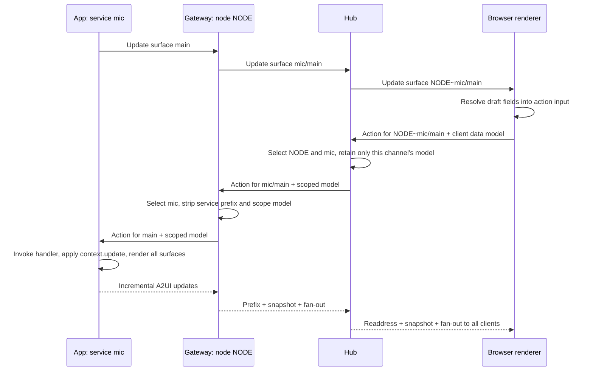
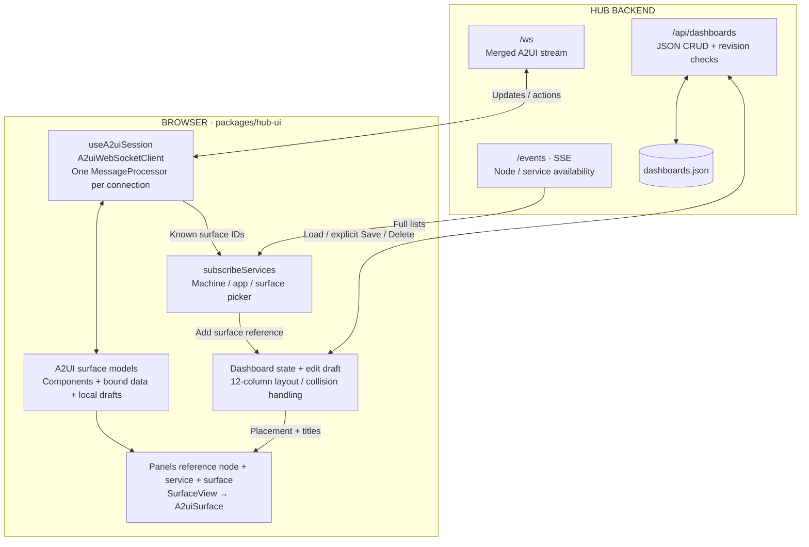
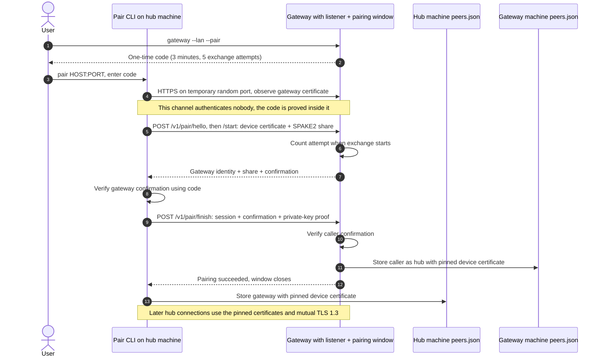
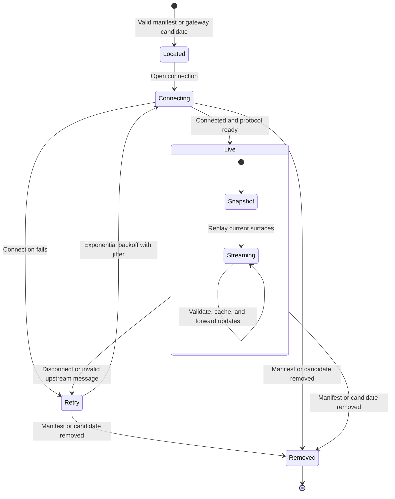
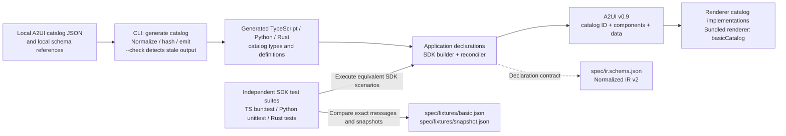

# Architecture

[Overview](../README.md) · [SDK guide](sdk.md) · [CLI reference](../packages/cli/README.md) · [Discovery guide](discovery.md)

This document maps the current implementation: all nine packages, the processes
started by the CLI, the protocols between them, and the ownership of state and
persistent data. The diagrams describe existing behavior, not a future design.

| View | What it answers |
| --- | --- |
| [System map](#system-map) | Where does every runtime component fit? |
| [Package dependencies](#package-dependencies) | Which package depends on which? |
| [Inside one application](#inside-one-application) | How do declarations become incremental UI updates? |
| [Preview one app](#preview-one-app) | What starts, and which process serves the page? |
| [Compose dashboards](#compose-dashboards) | How are applications discovered and aggregated? |
| [Routing and boundaries](#routing-and-boundaries) | How does an action reach exactly one app? |
| [Browser and dashboard state](#browser-and-dashboard-state) | Which traffic updates the UI, service picker, and layout? |
| [State and storage](#state-and-storage) | What is authoritative, cached, or saved? |
| [Remote access and trust](#remote-access-and-trust) | What do SSH, mDNS, pairing, and TLS each do? |
| [Failure and recovery](#failure-and-recovery) | What disappears, survives, and reconnects? |
| [Catalogs and conformance](#catalogs-and-conformance) | How are SDKs, schemas, and renderers kept aligned? |
| [Implementation index](#implementation-index) | Where is each responsibility implemented? |

## System map

[Open the full-size SVG](diagrams/architecture-overview.svg) · [PNG](diagrams/architecture-overview.png)

Solid arrows are live communication or data delivery. Dashed arrows are discovery,
configuration, or process startup. A box inside a process is a responsibility,
not another daemon. The preview, direct-transport, and hub paths are alternatives;
a program selects its transport when it starts.

The SDKs generate A2UI v0.9. `@omochi-ui/core` supplies the server-side snapshot,
validation, routing, JSONL, and fan-out primitives used by the bridge, gateway,
and hub. `@omochi-ui/discovery` implements both ends of the gateway protocol.
The remote gateway has its own identity and trust files on its host; the storage
table below distinguishes those from the hub's configuration.

The direct browser path works out of the box for a WebSocket endpoint. A callback
adapter needs a matching frontend integration if it uses another channel. Both
browser pages use the shared renderer, but have separate application code.

`dev` and `hub` both default to port 5555: run them separately or override a port.
Network discovery and TCP gateway listeners are disabled by default.

## Package dependencies

[Open diagram as SVG](diagrams/package-dependencies.svg)

Arrows mean **depends on**, not network traffic. Solid arrows cover every internal
JavaScript workspace dependency declared in package manifests. Dashed arrows show
shared contracts across the independent SDK implementations. External libraries
below are selected runtime dependencies, not the complete lockfile.

The SDKs do not import the gateway or hub. In particular, their Unix socket
transports implement the shared filesystem/wire contract independently rather
than calling `@omochi-ui/discovery`. TypeScript's Node server transports are exported
through `@omochi-ui/sdk/node`. Python and Rust have no dependency on the JavaScript
packages. `examples/` consumes the local SDKs; it is not another runtime layer.

The CLI's dependency on `hub-ui` is intentional: it imports the side-effect-free
`contracts` export and locates the `assets` export to serve the built dashboard.
This does not execute browser React code in the hub backend.

## Inside one application

[Open diagram as SVG](diagrams/sdk-runtime.svg)

The following responsibilities exist in each SDK; the TypeScript filenames label
one implementation. `App` registers declarations and callbacks, then builds one
`Runtime` around the state instance.

The transport arrows can traverse the bridge and aggregators from the system
map; those layers do not evaluate views or execute application callbacks.

- The root component ID is `root`; explicit keys keep conditional or reordered
  components stable. Component IDs are scoped to a surface.
- The reconciler compares declarations and sends incremental changes. Initial
  rendering sends a full surface; changing the catalog recreates it. Normalized
  IR remains inside the SDK and is not the wire protocol.
- `ui.local()` supplies initial values and reset keys. Ordinary rerenders preserve
  browser edits; an explicit reset replaces the corresponding local draft.
- Action handlers receive resolved input, not a renderer object. The wire action
  can carry client data model metadata; it is scoped in transit and is not
  automatically copied into authoritative app state.
- `Runtime.handle()` also accepts `getSurface` and `invoke` observations/commands.
  These SDK entry points are distinct from the browser's standard A2UI action.
- Transport capabilities are supplied to the reconciler before first rendering;
  this is not a network capability-negotiation protocol.

## Preview one app

[Open diagram as SVG](diagrams/single-app-preview.svg)

These are separate processes. `omochi-ui dev` starts the child app and bridge;
Vite serves the preview page. The browser can use Vite's `/ws` proxy or select a
direct endpoint with `?ws=`.

The bridge's port does not serve a page. Logs from the app belong on stderr;
stdout is A2UI JSONL. All browsers connected to one bridge share the same app
state. Late clients receive a compact current snapshot rather than event history.

| Transport | SDK availability | Typical connection |
| --- | --- | --- |
| `StdioTransport` | Python, TypeScript, Rust | Child app to bridge through stdin/stdout |
| `UnixSocketServerTransport` | Python, TypeScript, Rust | Discoverable app to gateway; multiple clients |
| `WebSocketTransport` | Python, TypeScript | Adapter around an existing WebSocket-like connection |
| `WebSocketServerTransport` | TypeScript, Node export | Browser directly to app's `/ws`; multiple clients |
| `CallbackTransport` / transport interface | Python, TypeScript, Rust | Application-supplied framework integration |

The direct TypeScript server and Unix socket servers maintain their own snapshots
for late clients. A generic callback or WebSocket-like adapter does not itself
supply discovery, a browser page, or multi-client routing.

## Compose dashboards

[Open diagram as SVG](diagrams/gateway-connection.svg)

A **service** is an app's published socket, identified by `serviceId`. A **node**
is a machine identity that survives gateway restarts. A **surface** is one view
published by an app. A dashboard places surface references, not arbitrary
components extracted from a surface.

The two gateway WebSockets form one logical connection: losing either closes
both. A separate `GET /v1/services` endpoint exists for inspection; the hub gets
its live service list from `/v1/control`, not polling that endpoint.
Browser startup requests may run concurrently; their order above is illustrative.

With no explicit target, the hub locates the local gateway and can start it if
missing. `--gateway` and `--ssh` replace that default selection. The supervisor
reuses an existing gateway and stops only a child gateway it owns. Applications
must already be running; the hub and gateway do not launch them.

## Routing and boundaries

[Open diagram as SVG](diagrams/action-routing.svg)

One browser connection can contain surfaces from many apps and machines. Surface
IDs provide routing without an extra omochi session envelope.

`NODE` is an illustrative node ID. Actual IDs are validated. Draft metadata for
another app is removed before forwarding; action routing does not change which
app owns the authoritative state. All connected clients of that app observe its
updates. Different dashboards referencing one surface are not independent app
sessions.

| Boundary | Channel / endpoint | Payload |
| --- | --- | --- |
| App ↔ bridge | stdin/stdout | A2UI JSONL |
| App ↔ gateway | `<service>/a2ui.sock` | A2UI JSONL |
| Hub → gateway | `GET /v1/node` | Gateway protocol version and node identity |
| Hub ↔ gateway | `WS /v1/control` | Full service lists, ping/pong, bye |
| Hub ↔ gateway | `WS /v1/a2ui` | Namespaced A2UI updates and actions |
| Inspector → gateway | `GET /v1/services` | Node ID and current services |
| Browser ↔ bridge or direct TS server | `WS /ws` by default | A2UI updates and actions |
| Browser ↔ hub | `WS /ws` | A2UI with node/service surface IDs |
| Browser ← hub | `GET /events` (SSE) | Full service lists as `services` events |
| Inspector → hub | `GET /services` | Current merged service list |
| Browser ↔ hub | `/api/dashboards` and `/:id` | Dashboard CRUD, revisions, validation errors |
| Browser ← hub | `/`, `/index.html`, `/assets/*` | Built dashboard assets |
| Pair CLI ↔ gateway | `POST /v1/pair/start`, `/v1/pair/finish` | Pairing exchange during an open window |

Gateway HTTP/WebSocket routes run over a Unix socket locally, an SSH-forwarded
Unix socket, or the explicit TLS TCP listener. The app's Unix socket speaks
JSONL, while the gateway's Unix socket speaks HTTP/WebSocket; they are not
interchangeable endpoints.

## Browser and dashboard state

[Open diagram as SVG](diagrams/browser-state.svg)

Three traffic types serve different purposes. Selecting or moving a dashboard
panel does not create a new backend session.

The shared renderer registers `basicCatalog`, processes A2UI messages with
`@a2ui/web_core`, and renders with `@a2ui/react`. It reports malformed server
messages without tearing down other surfaces on that connection.

The preview frontend only renders the surfaces on its connection. The hub
frontend adds discovery, dashboard selection, layout editing, and persistence.
Unsaved edits live in browser memory. Cancel discards them; a revision conflict
returns HTTP 409 and asks for a reload while preserving the local edit draft.

Hub frontend development uses a separate Vite process (`@omochi-ui/hub-ui dev`) that
proxies `/ws`, `/services`, `/events`, and `/api` to the hub. Normal `omochi-ui hub`
serves its built frontend directly and needs no Vite process.

## State and storage

| Data | Owner | Lifetime / location | Role |
| --- | --- | --- | --- |
| Application state | SDK runtime in app process | Memory; persistence is the app's responsibility | Authoritative business state |
| Previous declarations | SDK reconciler | Memory, per surface | Compute incremental component/data changes |
| Local input drafts | Browser MessageProcessor | Memory, per connection under `/$local` | Editable input; preserved across normal rerenders |
| Direct/Unix server snapshot | SDK server transport | Memory, per hosted app | Initialize late clients |
| Bridge snapshot | Bridge | Memory, one app | Initialize late browser clients |
| Service snapshots | Gateway | Memory, per service | Validate and replay merged app streams |
| Node snapshots | Hub | Memory, per gateway connection | Validate and replay merged gateway streams |
| Registry manifest and socket | SDK Unix server transport | `<runtime>/omochi/<serviceId>/{manifest.json,a2ui.sock}` | Discover app and connect |
| Gateway socket | Gateway | `<runtime>/omochi/gateway.sock` | Local HTTP/WebSocket access |
| Node identity | Discovery auth module on each machine | `<config>/omochi/node.json` | Persistent node ID, display name, private key and device certificate |
| Peer trust | Discovery auth module on each machine | `<config>/omochi/peers.json` | Paired peer IDs, roles, certificate pins, and timestamps |
| Saved dashboards | Hub's DashboardStore | `<config>/omochi/dashboards.json` | Names, surface references, layout, revisions |
| Unsaved dashboard draft | Hub UI | Browser memory | Editing before explicit Save |
| SSH forward socket | CLI SSH wrapper | Private temporary directory | Local endpoint forwarding to remote gateway |

`<runtime>` is `XDG_RUNTIME_DIR`; when unset, the registry root is
`<system temp>/omochi-<uid>/omochi`. `<config>` is `XDG_CONFIG_HOME`, defaulting to
`~/.config`. Service IDs and manifest socket/icon fields are validated before use.
Private runtime/config directories use mode 0700; identity, trust, and dashboard
JSON files are written with mode 0600.

Snapshots materialize server messages; they are not a durable event log or a
backup of application state. Browser drafts are not shared authoritative state
and are not guaranteed to survive a reload or reconnect. Dashboard files contain
no application state or draft input. Use one hub process per dashboard config
directory; revision checks handle concurrent browser edits, not cross-process
file locking.

## Remote access and trust

| Path | How it reaches a gateway | Authentication / boundary |
| --- | --- | --- |
| Local default | Private Unix socket | Owning user's runtime directory permissions |
| `hub --ssh HOST` | OpenSSH forwards the remote Unix socket into a private local temp directory | SSH login and host-key checks; no omochi pairing needed |
| `hub --gateway NODE@HOST:PORT` | Explicit TCP endpoint | Pinned device certificates through mutual TLS 1.3 |
| `hub --discover-lan` | mDNS yields TCP candidates and claimed node IDs | Discovery is untrusted; paired TLS is still required |

A gateway opens TCP only with `--listen` or `--lan`. `--advertise` adds mDNS and
requires a listener; `--lan` combines listening on `0.0.0.0:5556` and advertising.
The TXT record contains protocol version, node ID, and base path, not peer keys or
app data. A hub does not open a TCP connection without a pinned gateway certificate.

Pairing introduces two machines before ordinary TLS access:

[Open the pairing diagram](diagrams/pairing.svg)

SPAKE2 runs over P-256 with actual device IDs and binds both certificates, the session,
protocol version, and normal port. Pairing has a dedicated random-port HTTPS listener;
it never exposes application routes. The normal listener requires TLS 1.3 and client
certificates. Peer roles and exact certificate fingerprints authorize HTTP and WSS.
Trust updates are serialized across processes; revocation waits for running processes
to close affected connections. Legacy PSK pairings require registration again.
Outgoing HTTPS disables pooled agents. See [discovery](discovery.md#pairing) for details.

The hub's browser-facing HTTP/WebSocket listener is separate from gateway TLS.
It defaults to loopback, has no TLS or login, and applies origin checks to HTTP
requests and WebSocket upgrades. `--allow-origin` widens that exact-origin list.
The development bridge and direct TS WebSocket server also default to loopback
and have no authentication or TLS.

## Failure and recovery

[Open diagram as SVG](diagrams/recovery.svg)

The gateway applies the following lifecycle to each service; the hub applies the
same isolation principle to each gateway connection. This is a conceptual
lifecycle, not a list of exported status enum values.

| Event | Result |
| --- | --- |
| App connection drops or sends invalid updates | Gateway retracts that service's surfaces with `deleteSurface`, clears its snapshot, reports status/reason, and retries |
| App crashes leaving a manifest | Gateway keeps the advertisement, reports disconnection, and retries; it does not delete an app's manifest |
| Gateway connection drops or either WS closes | Hub closes the logical connection, retracts that node's surfaces, and retries independently of other nodes |
| Same service/node returns | Fresh snapshots restore its surfaces; dashboard panels retain their saved placement |
| Browser disconnects | Shared client clears its processor and retries after one second; the server initializes it from current snapshots |
| Browser sends invalid input | Bridge, gateway, or hub closes that client socket; other clients continue |
| Bridge child emits invalid JSONL | Bridge closes connected clients and terminates its child |
| SSH process exits | CLI exits the hub and cleans up the SSH forward; rerun to reconnect |
| Hub stops | Its own gateway child and SSH forward are cleaned up; reused or remote gateways remain running |

The hub and gateway recover connections, not application processes. Neither
restarts an app that has exited. A retained panel displays unavailability until
the referenced node/service/surface becomes available again.

## Catalogs and conformance

[Open diagram as SVG](diagrams/catalogs-conformance.svg)

Custom catalog generation is a build-time path, separate from discovery and
runtime message forwarding.

Codegen reads local inputs and does not fetch schemas over the network. Generated
SDK types do not implement browser components: a custom catalog also needs a
matching renderer implementation. The bundled frontend currently registers the
basic catalog.

The SDKs have separate builders, reconcilers, transports, and snapshot code.
Shared fixtures check observable behavior across languages, including exact
message sequences and snapshot materialization. The server-side bridge and
aggregators use the shared `@omochi-ui/core` snapshot implementation. Protocol changes
must update the affected SDKs, their tests, and the shared fixtures together.

Gateway protocol version `1`, normalized IR version `2`, and A2UI wire version
`v0.9` describe different contracts. A gateway handshake validates its protocol
version; the renderer consumes the A2UI wire version.

## Implementation index

| Responsibility | Source |
| --- | --- |
| CLI dispatch, help, and command lifecycle | [`cli.ts`](../packages/cli/src/cli.ts), [`help.ts`](../packages/cli/src/help.ts) |
| App / Runtime / action dispatch | [TypeScript](../packages/sdk/typescript/src/app.ts), [Python](../packages/sdk/python/src/omochi_ui/app.py), [Rust](../packages/sdk/rust/src/app.rs) |
| Declarations and reconciliation | [TS builder](../packages/sdk/typescript/src/builder.ts), [TS reconciler](../packages/sdk/typescript/src/reconcile.ts), equivalent modules in each SDK |
| Direct Node server transports | [`typescript/src/node`](../packages/sdk/typescript/src/node) |
| Unix app publication | [TypeScript](../packages/sdk/typescript/src/node/unix-socket-server-transport.ts), [Python](../packages/sdk/python/src/omochi_ui/unix_server.py), [Rust](../packages/sdk/rust/src/unix_server.rs) |
| Stdio bridge | [`stdio-websocket-bridge.ts`](../packages/cli/src/stdio-websocket-bridge.ts) |
| Snapshot / validation / fan-out / routing | [`core/src`](../packages/core/src), especially [`prefix.ts`](../packages/core/src/prefix.ts) |
| Manifest provider and Unix connector | [`discovery/src/app`](../packages/discovery/src/app) |
| Gateway server / client / wire contract | [`server.ts`](../packages/discovery/src/gateway/server.ts), [`client.ts`](../packages/discovery/src/gateway/client.ts), [`protocol.ts`](../packages/discovery/src/gateway/protocol.ts) |
| Local / static / mDNS gateway lookup | [`locator.ts`](../packages/discovery/src/gateway/locator.ts), [`mdns.ts`](../packages/discovery/src/gateway/mdns.ts) |
| Identity, trust, pairing, TLS | [`discovery/src/auth`](../packages/discovery/src/auth) |
| Hub aggregation and origin checks | [`hub.ts`](../packages/cli/src/hub/hub.ts), [`services-http.ts`](../packages/core/src/services-http.ts) |
| Gateway supervision / SSH | [`gateway-supervisor.ts`](../packages/cli/src/hub/gateway-supervisor.ts), [`ssh-gateway.ts`](../packages/cli/src/hub/ssh-gateway.ts) |
| Dashboard storage / built asset server | [`dashboards.ts`](../packages/cli/src/hub/dashboards.ts), [`static-ui.ts`](../packages/cli/src/hub/static-ui.ts) |
| Shared browser connection / surfaces | [`client.ts`](../packages/renderer/src/client.ts), [`surface.tsx`](../packages/renderer/src/surface.tsx) |
| Dashboard frontend / layout / contracts | [`hub-ui/src`](../packages/hub-ui/src) |
| Single-app preview | [`dev-server/src`](../packages/dev-server/src) |
| Catalog generation | [`catalog-codegen.ts`](../packages/cli/src/catalog-codegen.ts) |
| Language-neutral contracts and fixtures | [`spec`](../spec) |
| Runnable applications | [`examples`](../examples) |

Mermaid blocks in this file are the editable diagram sources. Each SVG is rendered from its corresponding block; the overview PNG is rendered
from the first block. Export settings and instructions are in
[`diagrams/README.md`](diagrams/README.md). Update diagrams alongside changes to
process boundaries, transports, package dependencies, or persistence.
